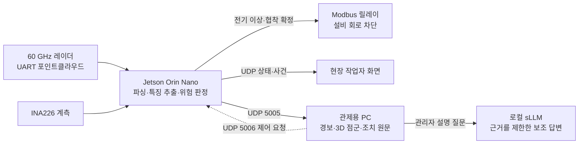

# Radar-Guard

**비영상 60 GHz 레이더로 작업 구역의 위험을 감지하고, 젯슨에서 판정과 설비 회로 차단을 수행하는 현장 안전 시스템**입니다. 이 저장소는 2026 한이음 드림업 2차 심사용 공개본입니다. 설명은 2차 심사 개발보고서와 제작설계서의 최종본을 기준으로 작성했습니다.

## 1. 프로젝트 개요

카메라를 설치하기 어려운 구역에서 mmWave 레이더의 포인트클라우드로 작업자 상태를 관찰합니다. 레이더 입력은 젯슨에서 처리하며, 관제용 PC가 꺼져 있어도 젯슨의 판정과 로컬 차단은 유지됩니다. 관제 화면은 젯슨이 확정한 사건을 표시하고 공식 안전 매뉴얼의 지정된 원문을 제공합니다. 언어모델은 관리자의 설명 질문에만 보조적으로 사용하며 판정·차단 경로에는 참여하지 않습니다.

본 실증 범위는 **천장 높이 2.30 m, 레이더 1대, Zone A의 감지 영역 1.44 × 1.44 m**입니다. 낙상은 경보와 조치 안내를 제공하고, 전기 이상·협착은 대상 설비 회로를 선택적으로 차단합니다. 여러 구역의 동시 실증 결과로 해석해서는 안 됩니다.

## 2. 팀원 소개

| 익명 표기 | 담당 역할 |
| --- | --- |
| 팀장 | 레이더 센서·펌웨어 운용, 실측 데이터 수집 |
| 팀원 A | 감지·판정 알고리즘, 레이더 파이프라인 |
| 팀원 B | 젯슨 송신부, 하드웨어 연동 |
| 팀원 C | 시스템 통합, 관제 UI, SOP 근거 조회 |
| 팀원 D | 스마트 차단기, Modbus 릴레이 제어 |

## 3. 시스템 구성도



차단은 젯슨 로컬에서 끝납니다. **낙상은 자동 차단 대상이 아닙니다.** 관제 화면의 표시나 언어모델 응답을 판정에 되먹이지 않습니다.

## 4. 작품 소개영상

[작품 소개영상 보기](https://www.youtube.com/watch?v=pbpunkD1_aA)

## 5. 핵심 소스코드

| 파일 | 역할 | 설계서 대응 |
| --- | --- | --- |
| [jetson_sender.py](src/jetson_sender.py) | 젯슨 판정·경보 상태·로컬 차단·UDP 송신 | RG-SRC-002~018 |
| [radar_common.py](src/radar_common.py) | 젯슨과 관제의 공용 사건·구역·통신 규약 | RG-SRC-019 |
| [radar_parser.py](src/radar_parser.py) | IWR6843 TLV 파싱 | RG-SRC-020 |
| [facility.py](src/facility.py) | 시설 평면도 좌표와 표시 영역 | RG-SRC-021 |
| [radar_core.py](src/radar_core.py) · [console_ui.py](src/console_ui.py) | 관제 화면과 공식 원문 조회, 관제 AI | RG-SRC-022 |
| [user_ui.py](src/user_ui.py) | 현장 작업자 화면 | RG-SRC-023 |
| [src/eval/](https://github.com/radar-guard-dreamup-2026/radar-guard-hanium/tree/main/src/eval) | 경보 화면 고정 원문 15문장·관제 AI 근거 구간·질문 경로와 스트리밍 시험 | RG-SRC-022 검증 자료 |

`src/`에는 화면에 필요한 3D 자산, 현재 보관된 모델 파일과 검증 스크립트도 함께 두었습니다. 레이더 설정 파일, 현장 DB, 원본 실측 데이터와 장비별 배포 환경은 포함하지 않았습니다.

## 검증 결과와 해석 범위

| 항목 | 2차 개발보고서에 기재된 결과 | 조건과 한계 |
| --- | --- | --- |
| 낙상 통합 검출 | 49/50회 | 최종 통합 설치 환경에서 반복한 낙상 동작 50회 기준 |
| 협착 판정 | 28/38회 | 4명이 수행한 해당 시연 표본 기준. 일반화 성능으로 쓰지 않음 |
| 낙상 판정 이식 대조 | 9,580건 중 불일치 0건 | 실측 5,580건과 합성 4,000건의 코드 대조 |
| 관제 AI 경로 | 141문항 회귀 평가 | 질문 유형별 경로 검사. 전체 정확도 수치가 아님 |

위 수치는 제출 개발보고서의 **「실물 통합 시연 및 검증 결과」와 「적용 알고리즘 및 핵심 기술」**에서 옮긴 값입니다. 이 공개본에서 별도로 다시 실행한 검사는 [검증 기록](evidence/검증_기록.md)에 구분해 적습니다. 누설전류·감전 시연에는 모의 조건이 포함되며, 실제 산업 현장 성능을 입증한 수치로 해석하지 않습니다.

### 공개한 관제 AI 평가 원본

| 보고서와 연결되는 항목 | 확인할 원본 | 해석 |
| --- | --- | --- |
| 10/10 스트리밍 첫 문장 중앙값 4.26초, 사고 질문 첫 문장 중앙값 5.68초 | [평가 JSONL](evidence/eval/final_highsec_1008_J3_temp0_exaone3.5_condB_stream_20261010_1517.jsonl) · [실행 메타데이터](evidence/eval/final_highsec_1008_J3_temp0_exaone3.5_condB_stream_20261010_1517_meta.json) | 답변 완료 시간과 구분 |
| 10/10 비스트리밍 사고 질문 완료 중앙값 7.7초 | [평가 JSONL](evidence/eval/final_highsec_1008_J3_temp0_exaone3.5_condB_20261010_1434.jsonl) | 같은 평가셋의 비교 실행 |
| 10/18 조건 A·B 비교와 사고 질문 완료 중앙값 34.9초 | [조건 A](evidence/eval/final_highsec_1008_J3_temp0_exaone3.5_condA_stream_20261018_2253.jsonl) · [조건 B](evidence/eval/final_highsec_1008_J3_temp0_exaone3.5_condB_stream_20261018_2251.jsonl) | 느려진 사례도 함께 공개 |
| 3개 언어모델 비교 | [EXAONE](evidence/eval/multi79_J3_temp0_exaone3.5_20261007_2104.jsonl) · [Gemma](evidence/eval/multi79_J3_temp0_gemma2_20261007_2013.jsonl) · [Qwen](evidence/eval/multi79_J3_temp0_qwen2.5_20261007_2030.jsonl) | 평가 기록의 작성자 필드만 익명화 |

각 실행의 요약 표와 메타데이터도 [평가 기록 폴더](https://github.com/radar-guard-dreamup-2026/radar-guard-hanium/tree/main/evidence/eval)에 함께 있습니다.

## 실행 범위

관제 화면의 데모 모드는 실장비 없이 화면·통신 형식을 확인하는 용도입니다. 실제 판정과 회로 차단을 재현하려면 레이더·젯슨·계측·릴레이, 모델 배포본, 현장 설정이 별도로 필요합니다. 공개본의 코드를 현장 안전 장치에 바로 배포하는 사용법은 제공하지 않습니다.

PowerShell, 이 저장소 루트에서:

```powershell
python src/console_ui.py
```

화면 실행에는 PyQt5, pyqtgraph, NumPy 등이 필요합니다. 실장비 검증과 데모 화면은 구분해 기록합니다.

## 공개 범위

개발 이력, 내부 인계 문서, 개인 정보, 접속 설정, 원본 동작 데이터와 대량 평가 로그는 이 저장소에 포함하지 않았습니다. 공개본은 필요한 소스코드와 선별된 검증 기록으로 구성합니다.
